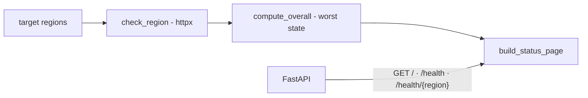

# status-page-multi-regiao

**English** · [Português (Brasil)](README.md)

[](#) [](#) [](#) [](LICENSE)

## What it is

**A multi-region status page**: a **FastAPI API** that checks the health of several regions (simulated checks with `httpx`), aggregates the overall state (`compute_overall`) and exposes a **status page** in JSON — in the style of public status pages (e.g. status.openai.com). It is an educational SRE/observability lab.

## Status

An educational lab, working and tested (13 tests).

## Features

- **Per-region check** (`check_region`): a `RegionHealth` with the state per region (up/degraded/down).
- **Aggregation** (`compute_overall`): the worst state among the regions becomes the overall state.
- **Status page** (`build_status_page`/`status_page`): a `StatusPage` with all regions.
- **Endpoints** (FastAPI):
  - `GET /` — the full status page (`StatusPage`).
  - `GET /health` — all regions' health (`Dict[str, RegionHealth]`).
  - `GET /health/{region}` — a specific region's health.
- **Real HTTP checks**: uses `httpx` to probe target URLs per region.

## Architecture

A `status_page_multi_regiao` package in `main.py`: check/aggregation logic + the FastAPI app (routes `GET /`, `/health`, `/health/{region}`).



## Stack

- Python ≥ 3.10
- FastAPI ≥ 0.100, httpx ≥ 0.24, uvicorn ≥ 0.23
- pytest (dev)

## Repository layout

```
status-page-multi-regiao/
├── pyproject.toml · BRIEF.md
├── src/status_page_multi_regiao/
│   └── main.py      # checks + aggregation + FastAPI
├── tests/           # 13 tests
└── LICENSE          # MIT
```

## Prerequisites and installation

```bash
pip install -e .
```

## How to run

```bash
uvicorn status_page_multi_regiao.main:app --reload
# status page: http://localhost:8000/
# per-region health: http://localhost:8000/health and /health/{region}
```

## Tests and quality

Real command (verified by the agent):

```bash
PYTHONPATH=src python -m pytest tests/
# 13 passed
```

## Technical decisions and trade-offs

- **Worst state wins** (`compute_overall`): the standard status-page rule — a degraded region degrades the whole.
- **FastAPI + Pydantic**: typed response contracts (`StatusPage`, `RegionHealth`).
- **httpx for probes**: a modern HTTP client with async support.

## Known limitations and roadmap

- Regions/targets are fixed examples in the code; no external configuration (YAML/ENV).
- No persisted history or incident window (not a full Statuspage/UptimeRobot).

## Development process

An individual project by Kelvin Oliveira, built with orchestrated AI agents and reviewed by the author.

## License and author

MIT — Copyright (c) 2026 Kelvin Rebelo de Oliveira. Author: [Kelvin Oliveira](https://github.com/KelvinOliveiraCode) · [Portfolio](https://kelvinoliveiracode.github.io/portfolio/)
