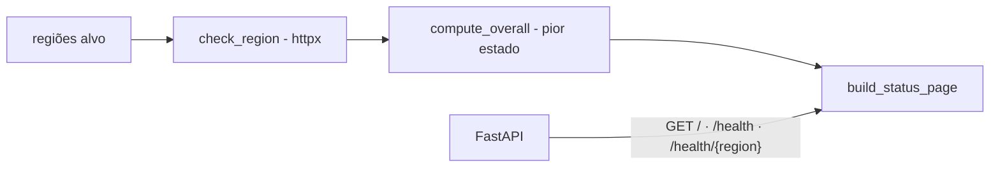

# status-page-multi-regiao

[English](README.en.md) · **Português (Brasil)**

[](#) [](#) [](#) [](LICENSE)

## O que é

**Status page multi-região**: uma **API FastAPI** que verifica a saúde de várias regiões (verificações simuladas com `httpx`), agrega o estado geral (`compute_overall`) e expõe uma **página de status** em JSON — estilo status pages públicas (ex.: status.openai.com). É um laboratório educacional de SRE/observabilidade.

## Status

Laboratório educacional funcional e testado (13 testes).

## Funcionalidades

- **Verificação por região** (`check_region`): `RegionHealth` com estado por região (up/degraded/down).
- **Agregação** (`compute_overall`): pior estado entre as regiões vira o estado geral.
- **Página de status** (`build_status_page`/`status_page`): `StatusPage` com todas as regiões.
- **Endpoints** (FastAPI):
  - `GET /` — página de status completa (`StatusPage`).
  - `GET /health` — saúde de todas as regiões (`Dict[str, RegionHealth]`).
  - `GET /health/{region}` — saúde de uma região específica.
- **Verificação HTTP real**: usa `httpx` para checar URLs-alvo por região.

## Arquitetura

Pacote `status_page_multi_regiao` em `main.py`: lógica de verificação/agregação + app FastAPI (rotas `GET /`, `/health`, `/health/{region}`).



## Stack

- Python ≥ 3.10
- FastAPI ≥ 0.100, httpx ≥ 0.24, uvicorn ≥ 0.23
- pytest (dev)

## Estrutura do repositório

```
status-page-multi-regiao/
├── pyproject.toml · BRIEF.md
├── src/status_page_multi_regiao/
│   └── main.py      # verificação + agregação + FastAPI
├── tests/           # 13 testes
└── LICENSE          # MIT
```

## Pré-requisitos e instalação

```bash
pip install -e .
```

## Como executar

```bash
uvicorn status_page_multi_regiao.main:app --reload
# página de status: http://localhost:8000/
# saúde por região:  http://localhost:8000/health e /health/{region}
```

## Testes e qualidade

Comando real (verificado pelo agente):

```bash
PYTHONPATH=src python -m pytest tests/
# 13 passed
```

## Decisões técnicas e trade-offs

- **Pior estado vence** (`compute_overall`): regra padrão de status pages — uma região degradada degrada o todo.
- **FastAPI + Pydantic**: contratos de resposta tipados (`StatusPage`, `RegionHealth`).
- **httpx para checagens**: cliente HTTP moderno com suporte a async.

## Limitações conhecidas e roadmap

- As regiões/alvos são exemplos fixos no código; sem configuração externa (YAML/ENV).
- Sem histórico persistido ou janela de incidentes (não é um Statuspage/UptimeRobot completo).

## Processo de desenvolvimento

Projeto individual de Kelvin Oliveira, construído com agentes de IA orquestrados e revisado pelo autor.

## Licença e autor

MIT — Copyright (c) 2026 Kelvin Rebelo de Oliveira. Autor: [Kelvin Oliveira](https://github.com/KelvinOliveiraCode) · [Portfólio](https://kelvinoliveiracode.github.io/portfolio/)
